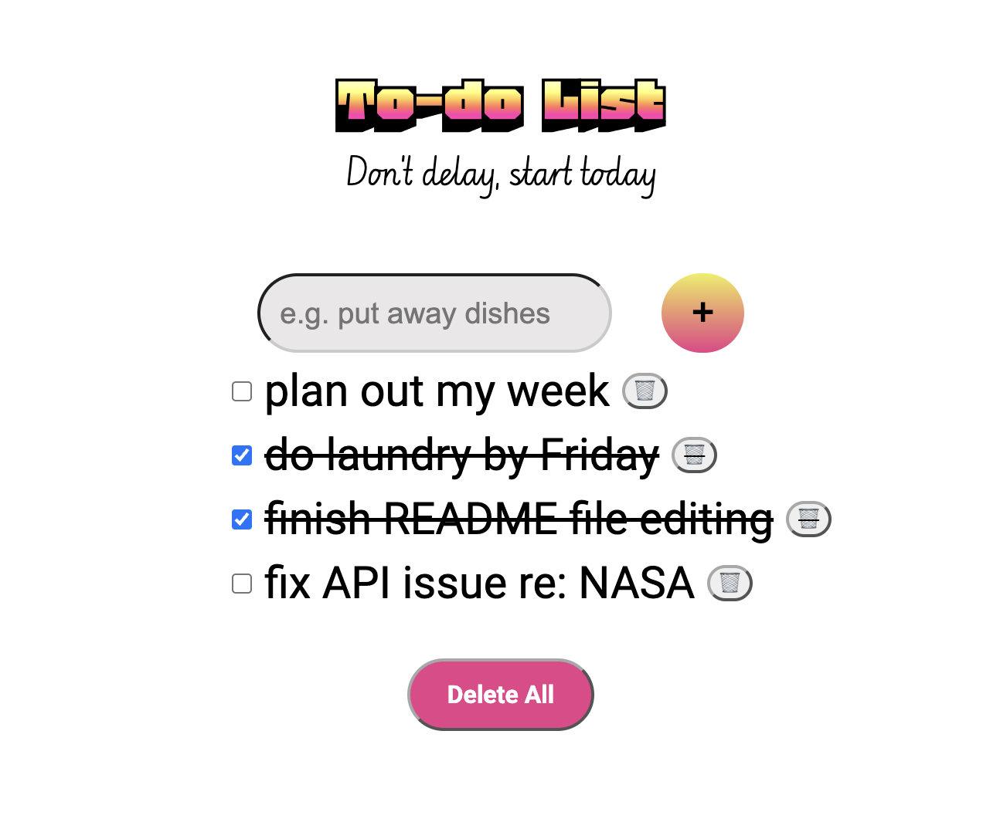

# ✅ Project Name: Todo List

## Project Goal: Build a Simple Todo List with the ability to add items, delete individual items, and delete all
 
### Languages Used: HTML, CSS, JavaScript

### What I learned:
- The font "Honk" is delightful
- How to use .apendChild() method
- How to use .prepend() method 
- How to add text-decoration in JavaScript

### Try it yourself! Check the repo I forked this project from and make the project your own! 
- Click the [link here](https://priscilla-ruilova.github.io/todo-list-week05-RC/) to use this to-do list

